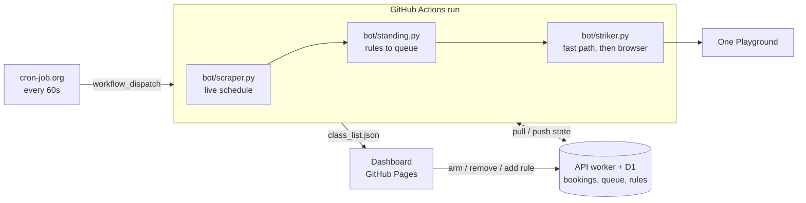

# ClassSniper

The system automates gym class bookings. It strikes the moment the booking window opens.

**Live dashboard:** https://classsniper.sidharthjoly.com/


## The problem

The gym chain this targets ([One Playground](https://oneplayground.com.au)) opens bookings exactly 72 hours before class. Popular slots and instructors sell out instantly. You can't be expected to sit at a laptop and click buttons at the exact right second. This automates the process.

## What it does

- **Strikes when the window opens.** An external cron triggers a run every 60 seconds. The bot books with a direct API call, and falls back to full browser automation if that's inconclusive.
- **Shows real classes.** A scraper pulls every location's live schedule on the same cadence: name, instructor, spots remaining.
- **Won't risk a cancellation fee.** It blocks arming or striking anything less than **30 hours** away. Cancellations within 24 hours cost a fee.
- **Standing rules** handle the weekly case. A rule describes it once. Every occurrence is queued as the scraper picks it up.
- **Losing the race isn't final.** A booking stays on a full class. It strikes the moment a spot reopens.

## How it works



The three run in that order every tick. A class scraped this minute matches a rule. It gets struck in the same run.

**Stack:** Python, [Playwright](https://playwright.dev), GitHub Actions, a Cloudflare Worker with D1, and vanilla HTML/CSS/JS (no framework, no build step) on GitHub Pages.

## Key engineering details

<details>
<summary><b>Failures cannot be quiet.</b> A vanished field once left the dashboard dead for four days.</summary>

That was the problem. We fixed it. `activity_type` vanished from the venue payload in September. The filter rejected every session. The scraper wrote an empty list. Because an empty picker looks like nothing happening, the dashboard stayed dead for four days. We have three layers now. The scraper asserts the payload has the fields the pipeline reads, including the two the *striker* posts to book. It refuses to overwrite a good class list with an empty or shrunken one. It writes a heartbeat on every run — including the runs that refuse — which the dashboard turns amber when it stops moving.

</details>

<details>
<summary><b>One lost class used to cost every booking behind it.</b></summary>

Selection took the earliest-opening eligible booking and returned after striking it. Only a win ever left the queue. A class that came back full was re-struck every 60 seconds for the ~42 hours until it hit the safety margin. Everything queued behind it never got a turn. It missed its window. An attempt now records its outcome on the booking. Resolved ones stay visible. They drop out of selection.

</details>

<details>
<summary><b>Class disambiguation.</b> Three different classes can share one time slot at one studio.</summary>

Multiple distinct classes share the exact same time slot at the same location (e.g. 5:00 PM Newtown might be *Athletica*, *Mat Pilates*, and *Reformer: Strong* simultaneously). Matching by date + time alone is ambiguous. An early version of this bot got this wrong. Every class now carries a unique `booking_id` sourced from the venue's own session API. It is matched exactly. No guessing.

</details>

<details>
<summary><b>The fast path.</b> The whole booking flow is two HTTP calls.</summary>

Found by reading the venue's own JS bundle instead of watching network traffic. The entire "click Book → sign in → confirm" flow the UI walks through is just two HTTP calls. Used directly. It is the same public API the site's own frontend calls. The full browser-automation flow stays as a tested, reliable fallback if the fast path fails.

</details>

<details>
<summary><b>A good fallback hides the failure.</b> The venue rebuilt its auth and nothing visibly broke.</summary>

The venue rebuilt auth in September 2026. `/person-auth` started 404ing. Sign-in moved to `/login`. The credential changed from a `personKey` in the booking payload to a session cookie. That payload is now keyed by `booking_id`. The fallback worked. Every strike worked. Nothing failed visibly. It just took twenty seconds instead of milliseconds. For a class that fills in seconds, that is the difference between success and failure.

</details>

<details>
<summary><b>Timing.</b> Sleep until just before the window, warm the connection, fire.</summary>

The strike moment is precise. It is 72h before class start. The process sleeps until just before that. It warms the HTTP connection ~5 seconds ahead of time. This keeps the DNS/TLS handshake off the critical path. Then it fires. It records the milliseconds after the window opens that the request went out. That number is the point of the entire system. The ten locations are scraped concurrently for the same reason: that scrape took ~25 seconds, which was a third of the 60-second tick it shares with the strike.

</details>

<details>
<summary><b>Why not GitHub's own scheduler?</b> Runs landed up to 75 minutes apart.</summary>

`schedule:` triggers on GitHub Actions are best-effort. They get deprioritized under load. In production, runs landed ~55-75 minutes apart despite a `*/5` cron. That is useless for "strike the instant it opens." An external cron service hitting `workflow_dispatch` every 60 seconds fixed the timing. It surfaced a second problem: overlapping runs racing each other on `git push`. I fixed this with a `concurrency` group (queue instead of running in parallel) plus a fetch-rebase retry loop around every push. A collision retries instead of failing.

</details>

<details>
<summary><b>Crash-safe cleanup.</b> Capture state before teardown, not after.</summary>

Screenshots and result state are captured from inside the still-alive Playwright context. They are not captured after teardown. That was an easy mistake. The previous version swallowed real failures because `status.json` never recorded what went wrong.

</details>

<details>
<summary><b>Credentials never reach the public repo.</b> A Playwright timeout once leaked the login email.</summary>

`status.json` used to be committed to a *public* repo. Playwright's own timeout errors embed the DOM element they were waiting on. This included the live `value` of the email input. It was the real login email in plaintext. I found this in an audit. I reproduced the leak. I fixed it at the source: the login-timeout handler now raises a clean message. I added two defense-in-depth layers. Debug screenshots mask any visible email/password field before capture (these are public Actions artifacts too). A final redaction pass scrubs exact credential matches from anything written to `status.json` regardless of source.

</details>

<details>
<summary><b>Respecting the platform.</b> At most 3 requests per attempt, and no retries.</summary>

The fast path makes at most 3 requests per attempt. It never retries. The login endpoint rate-limits at 5 requests. A fallback attempt needs some of that budget left for its own login. Repeated errors on one booking stop after 5 attempts. They do not retry for days. Watching a full class for a cancellation adds no requests. The scraper is already refreshing `remaining_spots` every 60 seconds. A freed spot is visible without asking again. A successful snipe costs two booking attempts — one to find it full, one to take the spot.

</details>

## What's public and what isn't

| | What | Where |
|---|---|---|
| **Public, no key** | The gym's timetable and a scrape heartbeat (`class_list.json`, `scrape_status.json`). No personal data. | This repo |
| **Behind the key** | Bookings, the queue, and standing rules. A standing rule means "this person is at this gym at this time every Monday." | The [worker's](worker/README.md) database |

Anyone with the access key can use the dashboard. You paste it once. There is no account and nothing to install. Old commits contain some past bookings; the history wasn't rewritten.

## Tests

```
pip install -r requirements.txt -r requirements-dev.txt
python -m pytest tests
```

They run against a trimmed, date-shifted recording of the real session payload, and cover what actually went wrong: a vanished field, a half-failed scrape, a full class blocking the queue, a standing rule loose enough to arm a whole day's timetable, an auto-armed booking reappearing after you delete it. The worker has its own suite (`cd worker && npm test`). CI runs them on push and PR only.

<details>
<summary><b>Setup</b> (to adapt this for your own use)</summary>

1. Fork the repo.
2. Add repo secrets: `GYM_EMAIL`, `GYM_PASSWORD`.
3. Enable GitHub Pages: Settings → Pages → Source: **GitHub Actions**.
4. Enable Actions if the fork disabled them by default.
5. Deploy the API worker — see [worker/README.md](worker/README.md). It holds
   your bookings and serves the dashboard's writes. Put its URL in `API_BASE`
   at the top of `index.html`. Add `CLASSSNIPER_API` and
   `CLASSSNIPER_BOT_TOKEN` as repo secrets. The workflow needs them to reach it.
6. **Set up the external trigger** — don't skip this. The repo's own `schedule:`
   cron is a free backup. It isn't reliable enough to strike on time (see above).
   Create a second
   [fine-grained token](https://github.com/settings/personal-access-tokens/new)
   scoped to this repo with **Actions: read & write** only. Use a free
   service like [cron-job.org](https://cron-job.org) to `POST` every 60s to
   `https://api.github.com/repos/<you>/<repo>/actions/workflows/main.yml/dispatches`
   with header `Authorization: Bearer <token>` and body `{"ref":"main"}`.

</details>

## Safety & scope

This automates one personal account, for a service where the operator is a paying member. It uses the same public interfaces as the website. It doesn't bypass authentication, access other members' data, or exceed the platform's documented rate limits.

## License

MIT — see [LICENSE](LICENSE).
