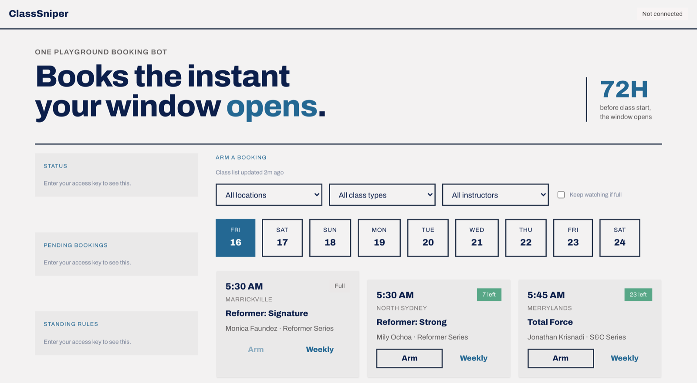
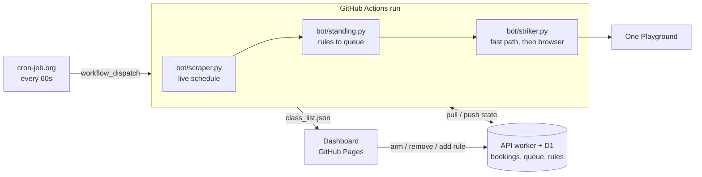

# ClassSniper

Books a gym class the instant its booking window opens.

**Live dashboard:** https://classsniper.sidharthjoly.com/



## The problem

My gym, [One Playground](https://oneplayground.com.au), opens bookings exactly 72 hours before each class, and the popular slots and instructors sell out within seconds. Sitting at a laptop to click Book at the right second, for several classes across several locations, isn't realistic, so I automated it.

## What it does

- **Books the moment the window opens.** An external cron triggers a run every 60 seconds. When a queued class's window opens, the bot books it with a direct API call, and falls back to driving a real browser if that doesn't give a clear answer.
- **Shows the real timetable.** A scraper pulls every location's live schedule on the same 60-second cycle, so the dashboard lists actual classes with their instructor and spots left.
- **Won't risk a cancellation fee.** Cancelling within 24 hours costs a fee, so it refuses to arm or book anything less than **30 hours** away.
- **Standing rules for weekly classes.** With a 72-hour window, a weekly class would need arming every week. A rule describes it once, and each occurrence is queued as it shows up in the scrape.
- **Keeps watching a full class.** If it loses the race, the booking stays on and it books the moment someone cancels.

## How it works



Every tick runs the three scripts in that order, so a class that shows up in this minute's scrape can match a rule and be booked in the same run.

**Stack:** Python, [Playwright](https://playwright.dev), GitHub Actions, a Cloudflare Worker with D1, and vanilla HTML/CSS/JS (no framework, no build step) on GitHub Pages.

## Key engineering details

<details>
<summary><b>Making failures loud.</b> A missing field once left the dashboard empty for four days.</summary>

In September, `activity_type` disappeared from the venue's session data. The scraper's filter relied on it, so it rejected every session and wrote an empty class list. An empty class picker looks a lot like a quiet day, and the dashboard sat empty for four days. There are three checks now. The scraper confirms the data has every field the pipeline reads, including the two the striker sends when it books. It refuses to replace a good class list with an empty or much smaller one. And it writes a heartbeat on every run, including the runs where it refuses, which the dashboard turns amber when it stops updating.

</details>

<details>
<summary><b>One full class used to block the whole queue.</b></summary>

The striker used to pick the earliest-opening booking, try it, and return, and only a successful booking ever left the queue. So a class that came back full got retried every 60 seconds for about 42 hours, until it reached the 30-hour safety margin, and every booking queued behind it missed its own window. Now each attempt records its outcome on the booking. Resolved bookings stay visible on the dashboard but drop out of selection.

</details>

<details>
<summary><b>Telling apart classes in the same slot.</b> Several different classes can start at the same time at one studio.</summary>

At 5:00 PM in Newtown there might be *Athletica*, *Mat Pilates* and *Reformer: Strong* all at once, so matching on date and time alone is ambiguous. An early version of the bot got this wrong. Every class now carries the unique `booking_id` from the venue's own session API, and the bot matches on that.

</details>

<details>
<summary><b>The fast path.</b> The whole booking flow is two HTTP calls.</summary>

I found it by reading the venue's JavaScript bundle rather than watching network traffic. Everything the site does when you click Book, sign in and confirm comes down to two HTTP calls to the same public API its own frontend uses, so the bot makes those calls directly. The full browser automation is still there as a tested fallback.

</details>

<details>
<summary><b>When the venue changed its login.</b> The fallback kept every booking working, just slowly.</summary>

In September 2026 the venue rebuilt its auth. `/person-auth` started returning 404, sign-in moved to `/login`, and the booking call switched from a `personKey` in the payload to a session cookie, with the payload now keyed by `booking_id`. Nothing failed, because the browser fallback picked up every strike, so nothing told me. Each strike just took twenty seconds instead of milliseconds. I updated the fast path to match, and added `bot/check_auth.py`, a by-hand check that it can still sign in.

</details>

<details>
<summary><b>Timing.</b> Sleep until just before the window, warm the connection, then fire.</summary>

A run that starts within 15 minutes of a booking window holds on and sleeps until five seconds before the strike. Then it warms up the HTTP connection, so the DNS lookup and TLS handshake are already done, sleeps the rest of the way, and fires two seconds after the window opens. It records how many milliseconds after opening the request actually went out, since that's the number all of this is meant to keep small. The ten locations are scraped concurrently for the same reason: one at a time, the scrape took about 25 seconds, a third of the 60-second tick it shares with the strike.

</details>

<details>
<summary><b>Why not GitHub's own scheduler?</b> Runs landed up to 75 minutes apart.</summary>

GitHub Actions' `schedule:` triggers are best-effort and get pushed back when GitHub is busy. With a `*/5` cron, my runs actually landed 55 to 75 minutes apart. Switching to an external cron that calls `workflow_dispatch` every 60 seconds fixed the timing, but it caused a new problem: overlapping runs racing each other to `git push`. A `concurrency` group now queues runs instead of running them in parallel, and every push is wrapped in a fetch-rebase retry loop, so a collision retries instead of failing.

</details>

<details>
<summary><b>Crash-safe cleanup.</b> Capture what happened before the browser closes.</summary>

Screenshots and the result are captured while the Playwright context is still alive, not after teardown. An earlier version did it afterwards, so real failures never made it into `status.json`.

</details>

<details>
<summary><b>Keeping credentials out of the public repo.</b> A Playwright timeout once leaked the login email.</summary>

`status.json` used to be committed to this public repo, and Playwright's timeout errors include the element they were waiting on. For the login form, that included the email field's live value, so my real login email ended up in a public file. I found it during an audit, reproduced it, and fixed it at the source: the login-timeout handler now raises a clean message. I also added two more layers. Debug screenshots, which are public Actions artifacts too, mask any visible email or password field before capture, and a final pass scrubs exact credential matches from anything written to `status.json`.

</details>

<details>
<summary><b>Respecting the platform.</b> At most 3 requests per attempt, with no retries.</summary>

The fast path makes at most three requests per attempt and never retries. The login endpoint rate-limits after five requests, and a browser fallback needs some of that budget left for its own login. If one booking keeps erroring, the bot gives up after five attempts instead of retrying for days. Watching a full class costs nothing extra, because the scraper already refreshes `remaining_spots` every 60 seconds. So a successful snipe takes two booking attempts: one that finds the class full, and one that takes the freed spot.

</details>

## What's public and what isn't

| | What | Where |
|---|---|---|
| **Public, no key** | The gym's timetable and a scrape heartbeat (`class_list.json`, `scrape_status.json`). No personal data. | This repo |
| **Behind the key** | Bookings, the queue, and standing rules. A standing rule amounts to "this person is at this gym at this time every Monday." | The [worker's](worker/README.md) database |

Anyone with the access key can use the dashboard. You paste it once and the browser remembers it, with no account and nothing to install. Some past bookings are still in old commits, since I didn't rewrite the history.

## Tests

```
pip install -r requirements.txt -r requirements-dev.txt
python -m pytest tests
```

They run against a trimmed recording of the real session data, date-shifted when it loads so a fixture can't start passing for the wrong reason as it ages. They cover the things that actually went wrong: a vanished field, a half-failed scrape, a full class blocking the queue, a standing rule loose enough to arm a whole day's timetable, and an auto-armed booking coming back after you delete it. CI runs them on pushes and PRs that touch the code, not on the bot's every-minute data commits. The worker has its own suite, which you run locally with `cd worker && npm test`.

<details>
<summary><b>Setup</b> (to adapt this for your own use)</summary>

1. Fork the repo.
2. Add repo secrets: `GYM_EMAIL`, `GYM_PASSWORD`.
3. Enable GitHub Pages: Settings → Pages → Source: **GitHub Actions**.
4. Enable Actions if the fork disabled them by default.
5. Deploy the API worker (see [worker/README.md](worker/README.md)). It holds
   your bookings and handles the dashboard's writes. Put its URL in `API_BASE`
   at the top of `index.html`, and add `CLASSSNIPER_API` and
   `CLASSSNIPER_BOT_TOKEN` as repo secrets so the workflow can reach it.
6. **Set up the external trigger.** Don't skip this: the repo's own `schedule:`
   cron is only a backup and isn't reliable enough to book on time (see above).
   Create a second
   [fine-grained token](https://github.com/settings/personal-access-tokens/new)
   scoped to this repo with **Actions: read & write** only. Then use a free
   service like [cron-job.org](https://cron-job.org) to `POST` every 60s to
   `https://api.github.com/repos/<you>/<repo>/actions/workflows/main.yml/dispatches`
   with header `Authorization: Bearer <token>` and body `{"ref":"main"}`.

</details>

## Safety & scope

This automates one personal account, mine, as a paying member. It uses the same public interfaces as the website, and it doesn't bypass authentication, access other members' data, or exceed the platform's documented rate limits.

## License

MIT — see [LICENSE](LICENSE).
